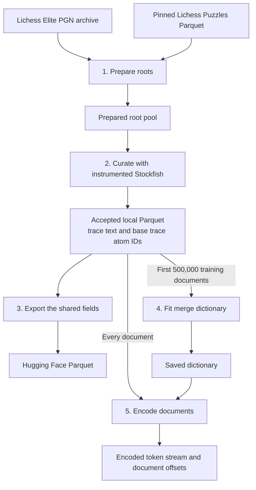

# Data curation and encoding

Pondera prepares roots from Lichess Elite and Lichess Puzzles, curates Stockfish traces, and produces Parquet for sharing and packed token streams for training.

**Produce each document's trace atom IDs once.** Curation writes the SAN trace text and its unmerged atom IDs together. Hugging Face export projects the text and its metadata. Fitting and encoding read the stored atom IDs from the accepted local release.

The Hugging Face projection and training encoding read the same accepted release. The trainer consumes the encoded documents and assembles batches of whole documents.

## 1. Prepare roots

The data recipe uses the November 2025 Lichess Elite archive and an ordered prefix of a pinned Lichess Puzzles revision. [Elite archive](https://database.nikonoel.fr/lichess_elite_2025-11.zip) · [Pinned puzzles revision](https://huggingface.co/datasets/Lichess/chess-puzzles/commit/461725966ea46898ec6481372a6326de3281bfbd)

- **Elite games.** Replay legal standard-start PGN mainlines, counting the starting position in the repetition history. Omit a game's final position when it has no legal move. Omit a per-game position key when its last occurrence reaches fivefold repetition. Record the archive URL when downloaded, PGN member, zero-based game index, and ply. Verify each downloaded archive before placing it in the cache. Count games in archive order before filtering so the provenance can recover the exact position and its history.
- **Puzzles.** Read the configured prefix of raw rows in sorted Parquet filename order and stored row order. Count the prefix before filtering or deduplication. Apply `Moves[0]` to the source FEN to obtain the puzzle root and retain its FEN clocks. Omit roots that end in mate or stalemate. Use repetition one for this position reconstructed from a single FEN. Preserve the original row, the Hub revision when verified, `root_after_moves = 1`, and `repetition_is_assumed = true`.

Deduplicate the combined candidates by the first four canonical FEN fields. They represent piece placement, side to move, castling rights, and the en passant square when the capture is legal. Keep the record with the highest repetition count. Ties keep the first occurrence, with Elite processed before puzzles. The winning record supplies the full FEN and provenance.

After deduplication, select 2,000 validation roots for training telemetry by seeded rank on the position key. Assign the rest to training. Shuffle the combined root pool with a fixed seed to mix Elite and puzzle roots before curation. The pool records each root's stable `fen|repetition` ID, FEN, repetition, split, and source. The prepared directory stores ordered row groups in `roots.parquet` and records pool identity and source counts in `pool.manifest.json`. The range reader can reopen any interval in that order.

## 2. Curate with Stockfish

The offline teacher is an external instrumented Stockfish 17.1 build. The shared data recipe supplies the seed, joint search width and depth distribution, presentation mix, and search and synthesis settings. Each root ID determines one width and depth pair and an independent presentation draw. The draw is stable across worker counts and shard ranges. Width `full` resolves to the root's legal move count. For a fixed width, the effective width is the smaller of the configured width and the legal move count. [Data recipe](../configs/data.toml) · [Stockfish producer procedure](../.agents/skills/stockfish-trace/SKILL.md)

Each worker keeps a single-threaded engine process and resets search state with `ucinewgame` before the next root. It sends the root FEN and a fixed depth, then consumes the completed JSONL sidecar. Synthesis writes one selected presentation per successful root. The `zero` presentation carries only the final answer, `full` includes the complete trace, and `random` cuts the reasoning at an interior operation boundary. Each presentation ends with `FINAL`, the chosen move or draw claim, its value and any mate distance, the principal variation when present, and the end marker.

Synthesis writes two representations of the same trace in each release row.

- `trace_text` is the portable grammar-v2 transcription. It uses absolute SAN and records the navigation operations, board observations, evaluations, and final answer.
- `trace_atom_ids` is the unmerged base atom sequence for that presentation. It includes the final answer and starts after the initial board prefix. Move and board observation atoms use the root player's frame. The local release also carries the atom count and per-state diagnostics used to validate the trace.

Each curation job reads its assigned half-open shard range. Jobs targeting the same release can work on disjoint ranges with the same pool, shard size, teacher, and recipe. Completed roots and published shards are reused on restart. Search timeouts are recorded as drops, and other collection failures receive up to three attempts across runs. The ordered release manifest is published once every root has a document or a recorded drop and at least one document has been produced.

## 3. Export to Hugging Face Parquet

The exporter projects each accepted row into the eleven-column shared schema. It writes `data/train-*.parquet` and `data/validation-*.parquet` and preserves the trace text, values, and source JSON. The Parquet part name carries split membership. Parts preserve the order within each split and roll over at a 256 MiB maximum by default. The exporter checks the size of the closed file and splits oversized parts, with a single-row part allowed to exceed the limit. The complete projection appears atomically. [Exporter](../tools/export_hf.py) · [Shared schema](../src/pondera/data/dataset.py)

| Arrow type | Fields |
| --- | --- |
| String | `fen`, `presentation`, `turn`, `trace_text`, `final_move`, `source` |
| Int16 | `repetition`, `teacher_depth`, `teacher_width`, `mate_distance` |
| Float32 | `final_value` |

`final_value` is `(W − L) / 1000`, using the win and loss counts from the deepest teacher result. A mate result supplies a signed `mate_distance` and a null `final_value`.

## 4. Fit the merge dictionary

Fit one dictionary on the first 500,000 published training documents in root-pool order. Use each document as curated, including full, zero, and randomly truncated presentations. The recipe's vocabulary size counts both base atoms and learned composite tokens. A composite expands to a sequence of two to eight base atoms.

Fitting and encoding share the same merge boundaries. `BACK`, `RESET`, `BOARD`, `FINAL`, `REFUTED`, `DEPTH`, and `END` remain standalone, as does the decision immediately after `FINAL`. Save the ordered atom expansions and reuse a fit for the same source snapshot, sample, and fitting settings. [Merge boundaries](../src/pondera/data/trace_encoding.py)

## 5. Encode every document

Read the stored base atoms in bounded batches. Apply the saved dictionary to each trace segment, choosing an encoding with the fewest tokens in that segment. Prepend the base board tokens derived from the document's FEN and repetition. Keep the document's split and presentation. Atom IDs name the fixed vocabulary, while encoded model token IDs can also name learned composites.

Encoding stages complete shards for reuse with the same source and dictionary. Final assembly streams those shards in release order and rebases their local offsets. If interrupted, assembly restarts from the staged shards. Disk space must accommodate both staged streams and the final output until publication.

The encoded document store contains these files.

| File | Content |
| --- | --- |
| `tokens.u16` | Concatenated model token IDs |
| `offsets.i64` | Document boundaries, including the final end offset |
| `split.u8`, `presentation.u8` | One split and presentation code per document |
| `packing.json` | Dataset identity, tokenizer version, merge boundaries, ordered dictionary entries, and document length cap |

Document `i` is `tokens[offsets[i]:offsets[i + 1]]`. The length cap selects training documents from the encoded store, and the packed-data reader assembles whole-document packs under the trainer's token budget. [Packed-data reader](../src/pondera/data/packing.py)
